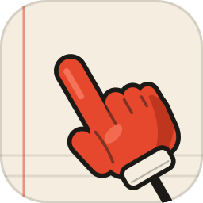
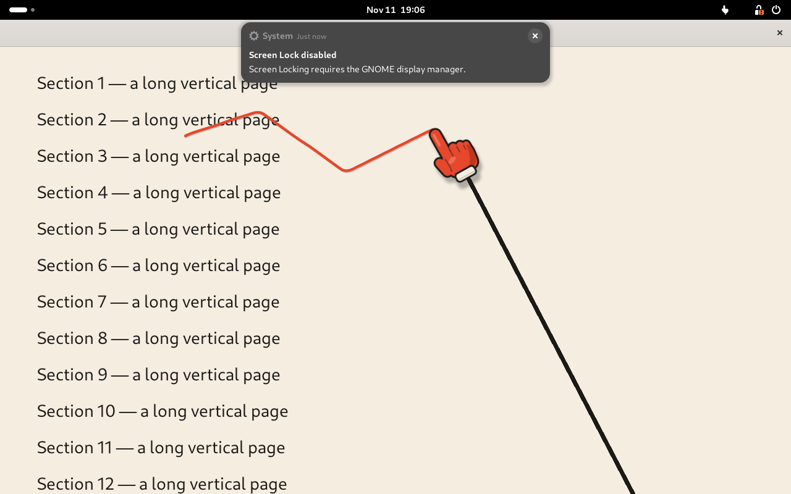
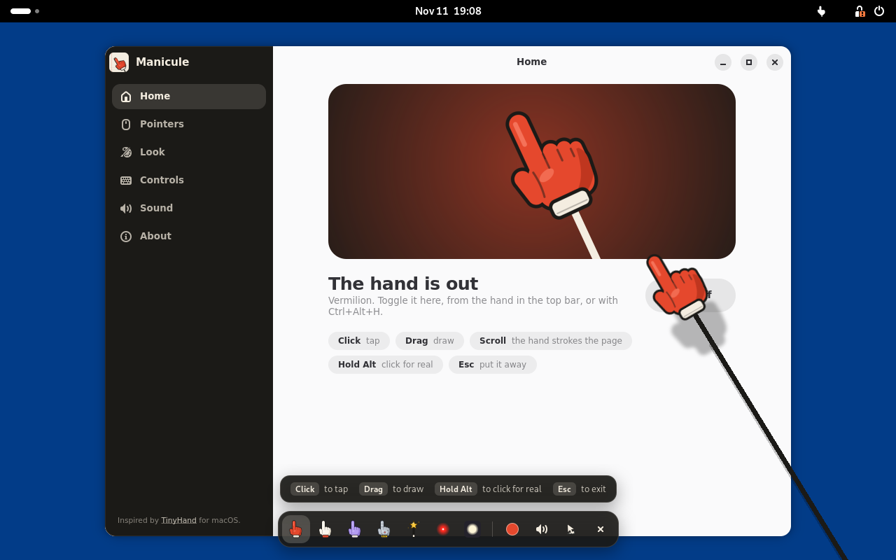

# Manicule

A little hand on a stick that points at things on your Linux screen.





It follows your mouse, taps when you click, draws when you drag, and opens up to stroke the
page along when you scroll. Made for demos, screen recordings and talks, on the GNOME desktop.

**[Website with a live demo](https://dabane-ghassan.github.io/manicule/)**

> Manicule is inspired by [TinyHand](https://tinyhand.app), the original hand on a stick for
> macOS, made by [Kamran Ahmed](https://github.com/nilbuild/tinyhand). The idea, and the way it
> behaves, are his; thank you. Manicule is an independent take on it for Linux: the code, the
> drawings and the sounds here are written from scratch.

## Install

```sh
curl -fsSL https://dabane-ghassan.github.io/manicule/install.sh | sh
```

Then **log out and back in once** so GNOME picks it up. After that, open **Manicule** from
your apps, or click the little hand in the top bar.

It works on any distro with the GNOME desktop, version 45 or later (Fedora 39+, Ubuntu 24.04+,
Debian 13, Arch). Nothing needs root: everything goes under `~/.local`. To remove it, run the
same line with `sh -s -- --remove` at the end.

## Update

```sh
manicule update
```

or press **Update Manicule** on the About page of the app. Both download the latest version
and install it over the old one; your settings and your own pointers are kept. Then **log out
and back in** once more, because GNOME only loads the new code at login.

If the `manicule` command is not found (older installs, or `~/.local/bin` is not on your
`PATH`), run the install line again; it does the same thing. To see which version you have,
open the About page or run `manicule state`.

## Use

| | |
|---|---|
| Click the hand in the top bar, or **Ctrl+Alt+H** | Turn the pointer on or off |
| Right-click the hand in the top bar | Menu: pointer style, sound, open the app |
| Click | Tap (nothing underneath gets clicked) |
| Hold and drag | Draw on the screen |
| Hold **Ctrl** while drawing | Add an arrowhead to the end of the line |
| Pin button in the toolbar | Keep drawings: they stop fading, so you can write and leave it up |
| Eraser button in the toolbar, or **Ctrl+Alt+X** | Erase every drawing |
| Scroll | The page scrolls, and the hand strokes it along |
| Hold **Alt** | Click for real while it is held |
| **Ctrl+Alt+C** | Click-through: every click reaches the app, the hand stays |
| **Esc** | Clear everything and turn the pointer off |

While the pointer is on, a small toolbar slides in at the bottom of the screen when the mouse
gets near it. From left to right: your pinned pointers, the ink colour, the **pin** (keep
drawings instead of fading them), the **eraser** (remove every drawing), the tap sound,
click-through, and the button that puts the hand away.

Switching the pin off again lets everything you kept fade as usual.

It stays on top of fullscreen windows, so it works over slides, videos and HTML presentations.
Keyboard keys always go to the app, so arrow keys still change slides.

### Pointers

Thirty to choose from.

- **Hands:** Vermilion, Parchment, Ink, Lilac, Mint, Sky, Sunflower, Bubblegum, Robot, Zombie,
  Neon, Gold, Skeleton, Scribe.
- **Magician's glove:** double-tap and it snaps its fingers. Every drawing vanishes in puffs of
  smoke and stars.
- **Boxing glove:** every tap lands with a comic-book POW.
- **Fly swatter:** every tap leaves a splat that fades after a moment.
- **Lobster claw:** it pinches shut while you hold the button.
- **Rocket:** leaves a trail of exhaust as it flies.
- **Magic wand:** sheds sparkles.
- **For neuroscience talks:**
  - **Electrode:** a glass pipette. Wherever it touches down, a little scope pops up with the
    action potential it recorded.
  - **Pyramidal neuron:** the stick is its axon. Drawing with it leaves a spike train instead
    of a plain line, and a tap stimulates: rings of activity spread from the spot.
  - **Optogenetics fibre:** a tap is a flash of blue light.
- **Also:** cat paw, foam finger, pizza slice, pencil, quill, a laser dot with a trail, and a
  spotlight that dims everything but a circle around the mouse.

You can add your own from any PNG with a transparent background, in the Manicule window under
Pointers. Draw it pointing straight up: the topmost point becomes the tip.

### How it moves

The motion is a small physical model, not a set of canned animations:

- The hand is a weight fixed to the end of a flexible stick. Sweep it quickly and the hand
  trails behind while the stick bends; stop, and it swings past and settles.
- The more level the stick, the more the hand end sags under its own weight.
- A tap is a strike: the hand hits the surface, rebounds slightly above its resting height and
  settles. Hold the button and it stays pressed down.
- Whoever is holding the stick follows your mouse with a springy delay of their own.

"Sway on the stick" in the Look settings turns the bending and sagging off, and the desktop's
"reduce animation" setting calms everything down.

### What is different from TinyHand

- The hand opens and strokes the page while you scroll.
- A stick that bends, a hand with weight, and taps that bounce (see above).
- Tap ripples and a rise-and-wave when it turns on. Each can be switched off.
- Toolbar buttons to keep drawings and to erase them.
- Pointers with their own tricks: the snapping magician's glove, the boxing glove, the fly
  swatter, the lobster claw.
- Rainbow ink, a spotlight pointer, and object pointers alongside the hands.
- Double-tap Shift for click-through exists but is off by default, with **Ctrl+Alt+C** in its
  place. On Linux Manicule cannot see which other keys you press, so typing `( )` quickly
  could look like a double tap.

## Automation

```sh
manicule toggle            # on, off
manicule clear
manicule pointer wand      # see: manicule list
manicule sound off         # on, off, toggle
manicule through on        # click-through
manicule ink keep          # keep drawings; "fade" lets them fade again
manicule update            # install the latest version
manicule state             # JSON
```

Links work too, for launchers: `xdg-open manicule://toggle` (`on`, `off`, `clear`,
`pointer/<id>`, `sound/<v>`, `through/<v>`, `ink/<v>`).

While it runs, the current state is mirrored to `$XDG_RUNTIME_DIR/manicule/state.json`:
whether the pointer is on, the selected pointer, sound, click-through, keep-ink, and every pointer with
its id, name and type. The same is available over D-Bus on `org.gnome.Shell` at
`/io/github/dabane_ghassan/Manicule`, which also emits `StateChanged`.

## How it is built, and its limits

Manicule is an app with two parts. The window (GTK 4 and libadwaita), the command and the
installer are ordinary. The hand itself is drawn inside GNOME Shell, because on Wayland only
the shell may draw over every window, hide the cursor and catch clicks. That is also why it is
GNOME only, and why it needs one log-out after installing.

- **Tested on GNOME 46, 49, 50 and 51.** The end-to-end suite in [`tests/`](tests/) runs a real
  headless GNOME Shell and passes on each of them (that covers Fedora 43 to 45 and Ubuntu 24.04
  to 26.10). Versions 45, 47 and 48 are declared as supported but have not been run. The tests
  use simulated input on a virtual screen, not a physical mouse, touchpad or GPU.
- While the pointer is on, apps under it do not see the mouse hover (no hover highlights or
  tooltips) unless you hold Alt or turn on click-through.
- Menus that an app opens get real clicks, so they stay usable.
- The tap sounds are synthesised by a script; I could check their length and loudness but not
  listen to them where this was built.

## Develop

```sh
make assets     # redraw pointers, sounds and logo from tools/
make install    # install for your user from this checkout
make test       # end-to-end tests in a headless GNOME Shell
make dist       # dist/manicule.tar.gz and manicule.shell-extension.zip
```

Everything visual is generated: [`tools/make_pointers.py`](tools/make_pointers.py) draws every
pointer as SVG, [`tools/make_sounds.py`](tools/make_sounds.py) synthesises the taps, and
[`tools/make_brand.py`](tools/make_brand.py) builds the logo. The website lives in [`docs/`](docs/).

## License

MIT. See [LICENSE](LICENSE).
